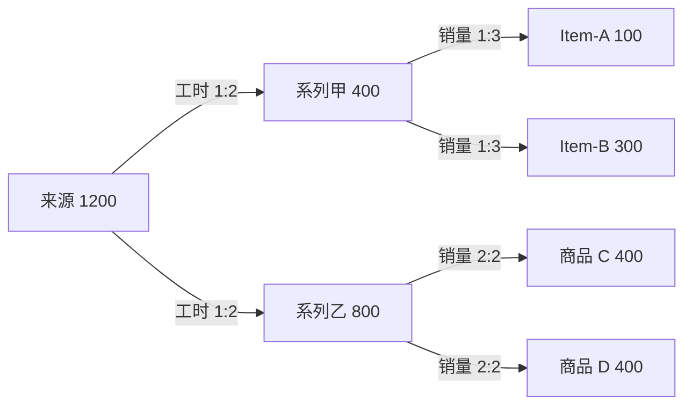

# Allocation-Core

**一个用于按业务规则分配金额、保留计算证据并进行独立对账的 Go 组件。**

它可以把费用或收入从来源维度分到组织、品牌、产品等目标维度，支持按工时、销量等 Driver 进行单阶段、多阶段和多因子分摊。业务人员可使用本地 Studio；开发人员可使用命令行、Go SDK，或通过 Java / Python 客户端调用同一计算内核。

> **当前定位：受控试点候选，尚未完成真实业务生产验收。** 合成数据测试通过不代表企业规则、Driver、业务范围和目标环境已验证。计算成功、金额守恒和独立业务对账是不同的检查，不能互相替代。


## 30 秒看懂一个例子

**以下全是合成数据。** 工厂有 1,200 元费用，先按工时 1:2 分到系列甲、乙，再按各系列的销量分到商品：



最终商品合计仍为 1,200 元。系列金额是中间结果，不能与最终商品金额再次相加。**总额相等也不能证明分对了**：还要核对来源范围、目标集合、Driver 和独立参考。

## 可以做什么

| 能力 | 说明 |
| --- | --- |
| 通用分摊 | 规则定义来源、目标、维度、Driver 和阶段依赖，支持单因子、多因子和多阶段。 |
| 固定精度 | 金额按规则精度使用整数计算；超出精度或数值范围时拒绝，不能静默舍入。 |
| 输入与范围检查 | 检查字段和数值；已声明的金额来源需连接或明确忽略。可配置来源未命中阻断及必需目标检查。 |
| 证据与对账 | 输出最终结果、阶段流水和守恒证据；可按完整业务坐标与独立参考对账。 |
| 多科目工作台 | Studio 和 Multi 支持按科目配置规则、运行任务、查看过程与比较历史运行。 |
| 多种接入 | Go 使用源码 SDK；Java / Python 使用轻量客户端调用本机 Core 程序。 |

**能力边界：**目标集合、Driver 权重及有效期间仍须业务提供；默认来源未命中可透传，必须按业务决定是否设置阻断。Studio 的 Visual Lab 实验页面保留在功能分支，不属于当前 `main` 的交付范围。

## 快速开始：Windows 合成示例

本示例仅生成合成数据。准备已解压的源码目录和适用于本机的 `AllocationCore.exe`。如果手头只有源码，可在安装 Go 1.23 或更高版本、并准备好构建依赖后，在源码目录执行 `go build -o AllocationCore.exe .`。普通构建不包含可选 MySQL 驱动。

将下面两个路径替换成实际位置，在 PowerShell 中执行：

```powershell
$exe = 'C:\AllocationCore\AllocationCore.exe'
$source = 'C:\AllocationCore\source'
$work = Join-Path $env:USERPROFILE ('AllocationCore-synthetic-' + [guid]::NewGuid().ToString('N'))
New-Item -ItemType Directory -Path $work | Out-Null

# 只生成合成 CSV；示例规则从源码包复制。
& $exe demo $work
if ($LASTEXITCODE -ne 0) { throw '合成数据生成失败' }
$rule = Join-Path $work 'examples\manufacturing\rule.json'
Copy-Item -LiteralPath (Join-Path $source 'examples\manufacturing\rule.json') -Destination $rule

& $exe inspect $rule --json
if ($LASTEXITCODE -ne 0) { throw '输入检查失败' }
& $exe run $rule (Join-Path $work 'run-memory') --workers 2
if ($LASTEXITCODE -ne 0) { throw '分摊执行失败' }
Import-Csv -LiteralPath (Join-Path $work 'run-memory\results.csv') | Select-Object sku,amount
Write-Host "合成输出目录：$work"
```

预期结果：Item-A 100、Item-B 300、商品 C 400、商品 D 400；显示顺序可能不同。每次执行使用新目录。要运行磁盘模式，只需使用新的输出路径并增加 `--disk-partitions 4`。更详细的执行和结果说明见 [图解产品交接手册](docs/Allocation-Core产品交接手册.md)。

### 启动本地 Studio

```powershell
& $exe serve
```

默认只监听本机 `127.0.0.1:8866`；若端口被占用，程序可能使用 8867–8885，实际地址以控制台的 `READY` 输出为准。关闭进程会停止服务。Windows 默认用户数据目录为 `%LOCALAPPDATA%\AllocationCoreCleanData`，可通过 `-data-dir` 指定私有目录。

## 如何接入自己的系统

| 使用方式 | 如何调用 | 需要了解 |
| --- | --- | --- |
| Go | `allocationcore/sdk` | 进程内复用 Core；需要编译。当前运行接口不支持 context 中途取消。 |
| Java 8+ | `clients/java/allocationcore/Client.java` 或编译后的 JAR | 通过子进程调用对应平台的 Core；返回 JSON。 |
| Python 3.10+ | `clients/python/allocation_core_client.py` | 通过子进程调用对应平台的 Core；返回字典。 |
| 命令行 / Studio | 运行对应平台程序 | 本地执行不等于已验证的多租户生产服务。 |

Java / Python 客户端不是另一套分摊引擎，也不是不依赖本机 Core 程序的原生库。示例、参数、错误处理和本地 Go 模块配置见 [组件接入说明](docs/组件接入说明.md)。

接入真实业务前，应由业务方提供冻结的金额来源、规则与阶段关系、Driver 数值及版本、层级和目标成员集合、独立参考结果，以及原系统其他规则可能造成的差异。**不要伪造 Driver，也不要根据结果倒推权重。** 真实文件、日志和对账明细应保存在授权的私有目录，不进入代码仓库。

## 结果应该怎么判断

| 检查结果 | 表示什么 | 仍需确认 |
| --- | --- | --- |
| 输入检查 `PASS` | 已检查的输入结构和数值有效 | Driver 覆盖、业务规则和分摊结果 |
| Core 运行 `PASS` | 内核执行及其检查完成 | 来源和目标是否符合业务定义 |
| 守恒通过 | 某阶段输入输出金额相等 | 各目标分得的金额是否正确 |
| 独立对账 `MATCH` | 所选两份数据在指定坐标、精度和容差下相符 | 参考数据本身、业务范围及其他规则影响 |

历史任务比较是**两次运行之间的差异**，与**本次结果和独立业务参考的对账**不同。输入或规则指纹变化本身不能证明金额变化的原因。

## 生产使用边界

- 真实业务规则、Driver、逐坐标对账和目标环境验收尚未完成。不能把合成测试结果作为生产通过证明。
- 输入快照按文件捕获，不是多个来源文件的事务快照；对账前也应冻结两侧输入。强杀或断电可能留下临时文件。
- 内存与磁盘消耗取决于数据分布、最大金额池、目标基数及对账分区。已有的百万级合成测量不是生产 SLA，目标硬件需要单独压测。
- 磁盘检查点可用于受控恢复，但跨版本兼容受限制；断电、磁盘满、多实例和长期恢复仍需目标环境验收。
- MySQL 为可选构建能力；Cube 提供通用适配接口。驱动或接口存在不代表已经完成企业数据库联调。
- 当前没有正式稳定版本兼容承诺和许可证决定。公开仓库不自动授予第三方复用许可。

详细状态、证据和未关闭门槛见 [生产就绪状态](docs/生产就绪状态.md)。

## 文档与源码导航

| 需要了解什么 | 从这里开始 |
| --- | --- |
| 产品全貌、流程图、接手步骤 | [图解产品交接手册](docs/Allocation-Core产品交接手册.md) |
| 金额、Driver、规则及对账契约 | [输入与规则说明](docs/INPUT.md) |
| Go / Java / Python 接入 | [组件接入说明](docs/组件接入说明.md) |
| 已验证范围和生产门槛 | [生产就绪状态](docs/生产就绪状态.md) |
| 系统设计与历史测试 | [架构](docs/ARCHITECTURE.md) · [测试与发布](docs/VALIDATION.md) |
| 历史首页更新记录 | [README 历史归档](docs/README历史记录.md)（可能包含过时描述） |

核心实现位于 `internal/engine/`，独立对账位于 `internal/acceptance/`，Studio 位于 `internal/studio/`，SDK 和客户端位于 `sdk/`、`core/`、`clients/`。

## 本地验证

在隔离的源码目录生成合成数据后，可运行：

```powershell
go build -o AllocationCore.exe .
.\AllocationCore.exe demo .
go test ./...
go vet ./...
```

`demo` 在指定目录生成合成文件，执行前请确认目录不是实际业务数据目录。关键模块的 race 测试还需要可用的 C 工具链；跳过 CI 或跳过测试不等于通过。CI 配置见 [.github/workflows/ci.yml](.github/workflows/ci.yml)。

---

**English:** Allocation-Core is a Go-based allocation engine with fixed-precision computation, auditable results and independent coordinate-level reconciliation. Java and Python clients invoke the same Core as a local process. Synthetic tests do not establish production readiness; validate business rules, drivers, reference results and target-environment capacity before deployment.
