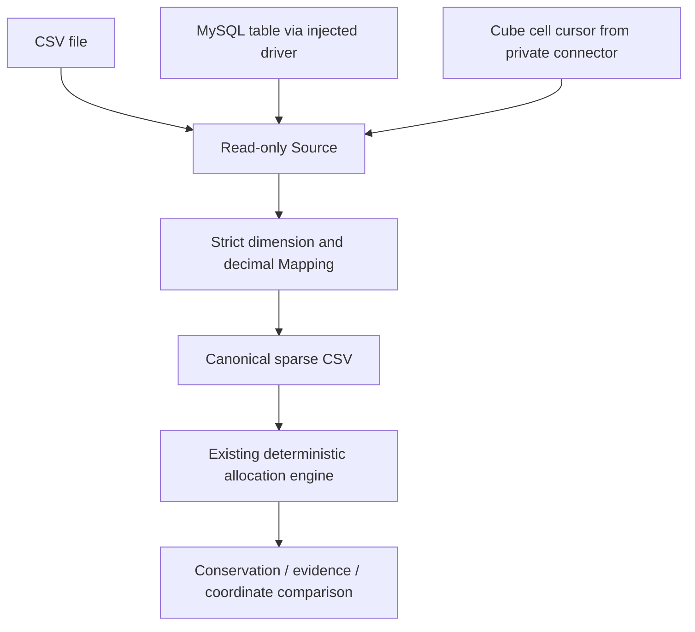

# Clean Core Architecture / 清洁内核架构

```text
AllocationCore.exe
  ├── Studio HTTP workspace / 统一业务工作台
  │     ├── Multi-account projects and jobs / 多科目任务
  │     ├── In-process Cube Explorer / 同进程对比
  │     └── Rule designer / 规则编辑
  ├── Exact engine / 精确计算内核
  ├── Generic rule converter / 通用规则转换
  ├── Driver indexes and disk partitioner / 因子索引与磁盘分区
  ├── Evidence + Vault / 审计及版本档案
  └── CLI subcommands / 命令行子命令
```

All components live in **one Go module** `allocationcore`, most under `internal/`; no extra executable files or scripting runtimes are necessary for normal Windows use. / 单一 Go 模块，不需要额外可执行程序或脚本运行环境。

**Important distinction / 重要说明**: the workspace and Explorer are truly served within one process. A cancellable execution job starts a **child process of the same exact executable** (`AllocationCore.exe core run ...`, `AllocationCore.exe multi ...`) for OS-level termination and fail-closed behavior. No binary is unpacked or fetched. This is **one executable distribution**, not a claim that every operation is single-process. / UI 真正合并为同进程；长任务为了安全取消仍使用同一个文件的子进程，不再释放七个不同 EXE。

### Stable money semantics / 不可牺牲的金额语义

- Fixed-point `int64` amounts, `big.Int` intermediate operations. / 定点金额、大整数中间运算。
- Deterministic largest-remainder apportionment. / 确定性尾差分配。
- Conservation for each configured pool and successful run. / 逐池守恒。
- No permissive fallback for unknown weights, dimensions, or source rules. / 未知规则、维度、权重必须明确拒绝。
- Stage graphs, trace evidence and atomic final publication remain intact. / 多阶段、审计和最终原子发布保留。
- Correctly handle the `math.MinInt64` subtraction edge case without altering normal arithmetic. / 修复最小负整数边界，不改变常规计算语义。

### Performance strategy / 性能策略

Current Go engine uses sparse grouping, parallel pools, optional disk partitions and content-addressed Driver cache. The cleanup itself does not prove a speedup. The next performance gate requires CPU/heap/I/O profiling for million-to-hundred-million row workloads under identical settings before adopting integer-coded dimensions or custom columnar storage. / 清理本身不代表提升性能；先用同条件真实基准剖析，再决定坐标编码等重构。

## V2 pool scheduling / V2 分摊池调度

A stage creates a bounded set of workers **once**. Pools are still processed in batches of at most `2 × workers`, and the coordinator publishes each batch in sorted pool order. Workers do not write shared output files. / 每个阶段创建一次固定工作池；内存仍被 `2 × workers` 的批次限制；写出严格按有序分摊池顺序执行，财务结果与血缘顺序不随线程执行顺序变化。

This improves repeated goroutine setup cost without changing rounding, rule routing, evidence contracts, or the input/output file format. It does not remove multi-account child-process overhead. / 该优化只降低协程调度成本，不改金额计算与审计协议，千科目子进程开销仍有进一步优化空间。

## V4: independent acceptance and shared Driver indexes / V4：独立验收与 Driver 索引共享

The financial engine is unchanged. The optional, read-only `internal/acceptance` package compares a published `results.csv` against independently prepared `reference.csv` using every business dimension, grouping duplicate full coordinates with fixed-point `big.Int` arithmetic. It uses 32 local hash partitions to reduce peak coordinate-map memory. Missing/extra coordinates are hard differences even if their amounts are zero; a matching grand total is not a sufficient test. No comparison results are published if either CSV is malformed or the operation is canceled. / 财务金额算法保持不变。新的只读验收组件按全部业务坐标归并重复记录并准确对比。采用 32 个本地分区降低聚合峰值内存；即使金额为零，缺失或多余坐标仍计为不一致；任何输入错误或取消都不发布结果。

The disk Driver cache key is formed from the source content SHA-256, selected weight column, Driver filters, target constraints, dimensions and hierarchies. Allocation labels, shares and negative Driver policy do not alter the stored index and therefore do not fragment its identity. Every cached entry is verified against its source and the committed data digest before reuse. Cache hit/build counts are diagnostic only, never a correctness verdict. / Driver 索引缓存只依赖确实影响索引内容的输入和语义，不再依赖计算后才使用的规则名称和份额。缓存读取仍验证源数据和索引 SHA-256，命中计数只是性能诊断，不代表业务验收通过。

Native MySQL code exists behind the optional `mysql` build tag; it requires the official dependency and has an isolated MySQL 8.4 CI test. The vendor-neutral Cube cursor is still an interface, not a completed vendor connector. The financial engine never performs cross-source joins implicitly. / MySQL 源码已实现、通过构建标签隔离依赖；Cube 仍为厂商无关接口，不能宣称已连通实际 Cube；金额引擎不会自动跨来源聚合。

## Clean V5: data source boundary / 数据源边界

The core financial engine remains independent of database and Cube vendors. A new read-only streaming contract is implemented in `adapter`:

**中文**：核心金额算法不接触数据库凭据和厂商 SDK。所有数据源必须通过统一的 `Source.Open(context.Context) (Rows, error)` / `Rows.Columns` / `Rows.Next` / `Rows.Close` 流式接口，并由 `ImportCSV` 严格映射成维度列＋精确数值列的规范化 CSV。整个过程不得推断或补齐维度，不得隐式笛卡尔展开，不得自动汇总重复坐标。

**English:** Database and Cube providers stream records through the same `Source`/`Rows` contract and `Mapping` validator. The adapter never auto-expands sparse dimensions, invents missing values, rounds amounts, or aggregates duplicates. The financial engine consumes the same normalized CSV regardless of the upstream vendor.

| Provider / 来源 | Current V5 status / 状态 | Safety boundary / 安全边界 |
|---|---|---|
| Headered CSV | **Executable CLI + API / 已实现且可直接使用** | Read-only source; atomic normalized output |
| MySQL via `database/sql` | **Executable, driver-injected Go adapter / 已实现 Go 接口** | Generated SELECT only, parameterized equality, read-only transaction, caller-supplied least-privilege credentials; **no bundled MySQL driver or live DB validation** |
| Multidimensional Cube | **Executable, vendor-neutral cell cursor adapter / 已实现抽象接口** | Caller implements `CellCursor.Next`; each cell retains explicit dimension members, including legitimate unassigned values; **no vendor SDK or live TM1 connection** |

### Data path / 数据流



In V5, `data csv` is a **local CSV normalization command only**. MySQL and Cube are validated Go interfaces, not claims of turnkey database connectivity. A private integration module can supply `SQLSource` with a registered driver or `CubeSource` with a cursor without modifying the engine. / V5 命令行仅直接支持 CSV；MySQL 和 Cube 需要调用方提供驱动或单元格读取器，不能将“接口支持”宣传为“生产直连已完成”。

## Coordinate and intermediate-data optimization / 坐标与中间数据优化

- `stageShardKey`: emit the original canonical JSON partition key without constructing a temporary dimension `map` for every record. **Exact old byte representation is retained**, including UTF-8 and JSON escaping. / 磁盘分区直接构造原字节键，去掉逐行临时维度 Map。
- `coordinateDictionary`: temporary 32-bit member IDs **per dimension**; pack into fixed-length in-memory keys. These IDs never appear in business outputs or lineages. / 维度成员临时编码成整数 ID，仅用于进程内分组；外部审计维度值不变。
- `mergeRows`: adaptive branch uses packed keys only for sufficiently large, repeated-coordinate workloads; sparse/mostly-unique coordinates retain legacy logic. The final merge still sorts by the legacy JSON key. / 多重复坐标时启用压缩分组，几乎全是唯一坐标时保持原算法；输出顺序与行 ID 不变。
- **Financial apportionment remains unchanged.** / 金额分配、舍入、负数和守恒公式未改。

### Profiling boundaries / 性能剖析边界

`AllocationCore profile RULE.json OUTPUT_DIR --workers 4 [--disk-partitions 8] [--evidence-gzip]` creates the usual complete allocation output plus a local `OUTPUT_DIR.profile/` containing `cpu.pprof`, `heap.pprof`, `metrics.json`.

**中文**：可以用 `go tool pprof -top <profile>/cpu.pprof` 查 CPU 热点，用 `go tool pprof -top <profile>/heap.pprof` 看堆对象。报告记录**采样的 Go HeapAlloc 峰值**，不是 OS 物理 RSS 峰值；Linux 读取进程 `/proc/self/io`，Windows 使用原生 `GetProcessIoCounters` 获取传输计数；两种口径不同，均不代表精确的物理磁盘写入量。`persisted_output_bytes` 仅是最终发布目录大小，不等于包含临时文件的全部磁盘写入量。生成 Profile 会产生额外 CPU/磁盘开销，不宜把该耗时直接当正式吞吐基准。

**English:** The peak heap value is sampled, not process RSS. Linux uses `/proc/self/io`; Windows uses `GetProcessIoCounters` transfer counters, which are not comparable to Linux physical read/write counters. Final persisted output bytes exclude temporary spool and cache I/O. CPU profiling adds overhead. Profile files may contain sensitive paths and must stay outside Git.

### Next measured bottleneck / 下一步经测量确认的瓶颈

The 50k-row disk-profile experiment identified the JSON intermediate-spool decoder and allocation churn as meaningful CPU/heap costs; importantly, they are part of audit-preserving disk processing. A future binary/columnar spool format needs version markers, checkpoint backward compatibility, error recovery, and byte-identical final evidence BEFORE deployment. / 5 万行 Profile 表明 JSON 中间记录反序列化以及临时对象分配是热点。但新二进制/列式中间格式必须同时满足旧检查点兼容、失败恢复、严格相同的账务输出与证据，不能只凭快就替换。

## Clean V6: shared snapshot source / 同快照数据接入

MySQL-native code lives exclusively inside `adapter/mysql_enabled.go` (enabled with `-tags mysql`). The financial engine does not import a driver. Both the MySQL `SQLSource` and vendor `CubeSource` produce the same `adapter.Rows` stream and pass through unchanged `adapter.ImportCSV` validation. MySQL bundles use one read-only REPEATABLE READ transaction for all related datasets and commit as a single directory after complete validation. A future Cube vendor connector should implement the same snapshot scope plus the `Rows` or `CellCursor` contract; it **must not** embed Cube-specific aggregation or business fallback inside `internal/engine`. / 数据源负责快照与读取；统一映射层负责坐标与精确数值检查；财务引擎只消费标准稀疏数据。Cube 未来连接器使用相同契约，不能另写金额算法。

The MySQL transaction read view is established by the first consistent SELECT and retained for all keyset pages. No mid-import failover/retry is permitted. An isolated connection is held until all tables have been streamed and checked. / 同一事务内的第一次一致性读建立读取视图，后续分页始终使用它；中途重连必须整批重新导出。

## V7 snapshot boundaries and financial oracle / V7 快照边界与独立金额证明

```text
MySQL least-privilege SELECT account / MySQL 最小权限账号
 -> BEGIN READ ONLY, REPEATABLE READ / 只读一致性事务
 -> Validate source table, unique signed BIGINT key, exact measure precision
 -> Keyset page data for all configured amount/Driver sources
 -> Write private, verified, SHA-256-recorded CSV files
 -> ROLLBACK to release snapshot (failure = no publication)
 -> Publish new output atomically inside one filesystem / 完整发布
 -> Independent full-coordinate reconciliation (optionally reject duplicates)
```

**Same snapshot, same metadata validation / 同一事务验证**: V6 first validated MySQL metadata in one transaction and exported in another. V7 moves all source checks into the export transaction itself. The metadata queries do not guarantee protection from all concurrent DDL races; metadata-lock behavior and release under DDL pressure still need real-server fault testing. / V7 修复元数据预检与导出分属两次事务的窗口；DDL 极端并发仍需针对目标 MySQL 验收。

**Strict SQL type check / 严格数值类型**: FLOAT/DOUBLE/text are not accepted as financial measure sources even if the driver returns strings. Integer and DECIMAL columns must fit configured precision. The row parser also checks each value for range and accuracy. / 原生 SQL 源必须是精确数值类型，精度超限必须拒绝。

**No new financial formula / 金额公式不变**: independent rational oracle tests live in `internal/engine/golden_oracle_v7_test.go`; fixed synthetic end-to-end expected values in `independent_e2e_v7_test.go`. / 公式不变，另以独立预期检验。

**Duplicate coordinates / 重复坐标**: legacy reconciliation intentionally aggregates duplicate coordinates but now counts them separately; `--reject-duplicates` opts into fail-closed acceptance. / 为兼容历史默认汇总，严格模式可立即阻断重复导入。

**Source scope / 来源范围**: MySQL's transaction guarantees only data from that MySQL database/session; a separate Cube system must carry explicit source version and freshness evidence. / MySQL 一致性不能自动推导 Cube 具备相同时间点的数据快照。


## V8 internal spool and MySQL TLS boundary / V8 中间文件与 TLS 边界

**Disk partitioning / 磁盘分区：** `partitionSpool` reads the private JSONL record once to derive the exact existing shard key, then writes the original record bytes verbatim. Large lines use a safe buffer fallback; truncated or invalid JSONL records fail closed. Only temporary partition records use this path. `scanSpool`, stage checkpoints, lineage, financial CSV and public JSON formats remain unchanged. / 仅临时分区减少重复编码，不变更检查点和公开文件格式。

**MySQL TLS / MySQL 证书：** `verifiedMySQLTLS` constructs the same TLS configuration used by the optional native MySQL driver. The server name must be explicit; CA roots must parse; minimum TLS version is 1.2; hostname verification cannot be disabled. Unit tests create an ephemeral CA and exercise an actual local TLS socket for correct/wrong SAN and CA. The CI job `mysql-tls-integration` provisions a separate MySQL 8.4 server that requires TLS; verify CI success before declaring native MySQL TLS end-to-end accepted. / 标准 TLS 握手测试在离线环境运行；原生 MySQL TLS 必须由隔离 CI 实测。

**DDL concurrency / 并发结构变化：** `TestV8LiveConcurrentDDLIsBlockedUntilSnapshotReleased` ensures metadata lock protection during a read-only REPEATABLE READ transaction. The test performs a concurrent `ALTER TABLE` against *ephemeral CI data only*, checks it waits, then releases the snapshot and checks DDL completes. It must never run against production. / 并发 DDL 测试仅使用短生命周期隔离数据库，不能连接生产环境。

## V9 disk partition memory budget / V9 分区内存预算

**English:** Ephemeral disk partitions retain the existing JSONL line format and content. `partitionSpool` now opens a shard writer only if that shard receives a row, then creates zero-byte files for unused shard paths to preserve reader and checkpoint compatibility. Partition buffers are bounded to `min(256 KiB, max(16 KiB, floor(2 MiB / N)))` per active shard, for `N` partitions. At 64 partitions, the maximum active writer-buffer budget is 2 MiB rather than 16 MiB. This cap applies **only to user-space partition writer buffers**; it does not bound Go heap in a large skewed pool, driver indexes, OS page cache, full process RSS or temporary disk capacity. Financial calculations and published evidence are unchanged.

**中文：** V9 只调整临时分区的写入缓冲和文件打开时机，保留全部 JSONL 原始内容与检查点结构。64 分区写入器最多占用 2 MiB 的用户态缓冲，不再预先为全部 64 个分区打开 256 KiB 缓冲。对没有记录的分区，仍生成兼容的空文件。**这不是整个 Go 进程的内存上限**，偏斜的 Pool、Driver 索引、操作系统缓存和临时磁盘占用仍需独立验收。

**CI caution / CI 边界：** V8's GitHub CI failed in two jobs: a missing benchmark output directory and `invalid connection` during the TLS test's administrative setup. V9 eliminates the latter test dependency by provisioning via the ephemeral container socket, then tests the actual read-only TLS connector with `have_ssl` and hostname verification checks. Updating GitHub and observing successful CI runs is necessary before declaring the issue fixed in live CI. / 此次属于针对已观察到的失败进行修复，不能把未经重新执行的 CI 标为通过。
