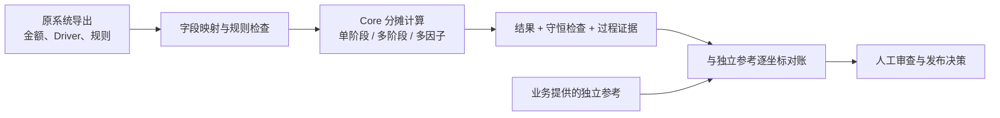
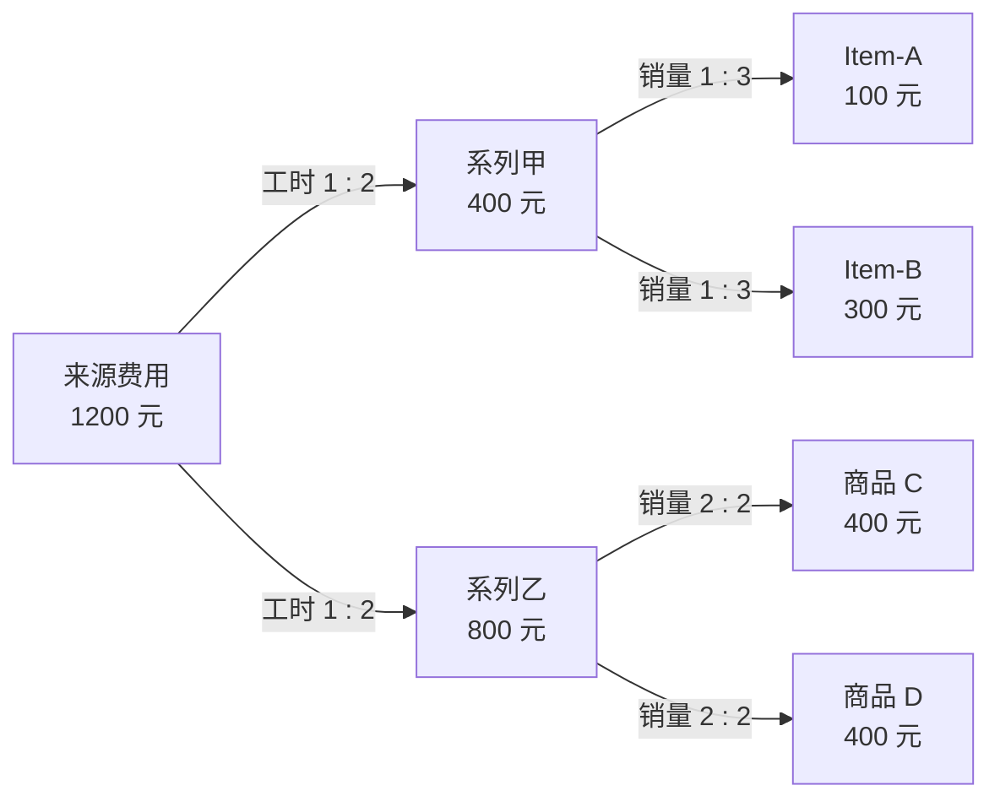
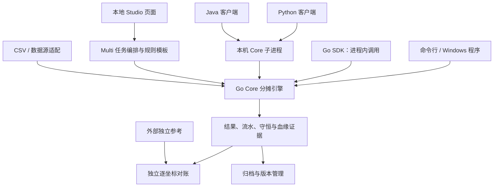
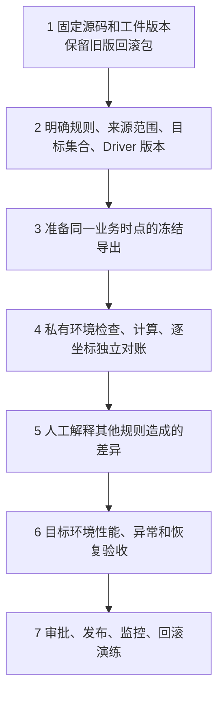

# Allocation-Core 产品交接手册

> 核对基线：`main` 的 `980c7f5`（2026-11-07）。本文使用合成样例，不包含真实业务规则或明细。代码继续变化后，应重新核对本文和测试结论。

## 1. 一页看懂：产品能做什么，还差什么

Allocation-Core 是一个**按规则把来源金额分配到目标业务坐标，并保留计算证据的组件**。它适用于费用或收入等需要按工时、销量等依据进行单阶段、多阶段或多因子分配的场景。业务人员可以使用本地 Studio；系统开发人员可以用 Go 接入，或通过 Java/Python 客户端调用同一 Go 内核。



**目前的定位：有合成测试支撑的受控试点候选，不是已经完成企业生产验收的产品。** 核心财务计算和多阶段样例有测试；企业真实规则、Driver、目标集合、参考对账、目标机器容量和长期恢复尚未验证。输入检查 PASS、运行 PASS、对账 MATCH 分别回答不同问题，不能合并成一个业务通过结论。

| 状态 | 意思 | 当前例子 |
| --- | --- | --- |
| PASS | 在明确范围内有通过证据 | 合成两阶段案例与独立手算一致 |
| PARTIAL | 有实现，但覆盖或证据不完整 | 目标完整性可配置；正确成员集合仍需业务提供 |
| BLOCK | 缺少必要条件或明确拒绝 | 超出精度、必需目标缺失、检查点不兼容等 |
| NOT_TESTED | 还没有对应证据 | 本企业真实逐坐标对账、目标环境断电恢复 |

## 2. 用一笔钱理解分摊

以下是仓库中的**合成数据**：工厂有 1,200 元费用，先按工时分给两个系列，再按销量分到商品。



最终结果是 100 + 300 + 400 + 400 = 1,200 元。系列的 400 和 800 是**中间阶段**，不能再与最终商品金额相加，否则同一笔钱会被重复统计。已有独立手算测试分别验证内存单 Worker、内存多 Worker 和磁盘执行；这只能证明该合成案例，不能证明任意企业规则正确。

| 业务词 | 通俗解释 | 示例 |
| --- | --- | --- |
| 来源 / Source | 需要分出去的金额，以及它原来属于哪些维度 | 工厂费用 1,200 元 |
| Driver | 决定如何分配的依据 | 工时、销量 |
| 权重 | Driver 在目标上的数值 | 两个系列工时 1、2 |
| 目标 / Target | 金额要落到哪些成员及维度 | 系列、商品 |
| 金额池 / Pool | 按规则分组后需要一起分配的一组金额 | 某期间、工厂、科目的费用 |
| 业务坐标 | 一条金额所对应的完整维度组合 | 期间 + 工厂 + 科目 + 商品等 |
| 守恒 | 分出去的钱与该阶段输入是否相等 | 1,200 分为 400 + 800 |
| 独立对账 | 与独立提供的参考按完整业务坐标比较 | 商品 A 是否确实应为 100 元 |

**金额守恒不等于分对了。** Driver 缺少应有目标、规则范围错或原系统另有规则时，总额仍可能相等。不得伪造权重，也不得根据结果倒推本该提供的业务 Driver。

## 3. 架构：一套计算核心，多种入口



| 部分 | 职责 | 源码位置 |
| --- | --- | --- |
| Core | 校验规则、金额池、Driver、固定精度计算、守恒和结果 | `internal/engine/` |
| 输入适配 | 将来源数据映射为明确的稀疏坐标和精确数值 | `adapter/` |
| Multi | 按科目组织模板、任务与多个规则配置 | `internal/multi/` |
| RuleKit | 规则模板和规则配置支持 | `internal/rulekit/` |
| Acceptance | 对两份结果按完整坐标精确比较 | `internal/acceptance/` |
| Vault | 归档、核验与版本管理 | `internal/vault/` |
| Studio | 本地网页、任务界面与 API | `internal/studio/` |
| SDK | Go 源码接口及 Java/Python 子进程客户端 | `sdk/`、`core/`、`clients/` |

Studio 不是第二套分摊算法。`main` 保留原有工作台；此前单独开发的 Visual Lab 在功能分支，**不应当作 main 已交付的能力**。MySQL 有可选驱动构建与导出实现，普通离线构建不链接驱动；Cube 有通用适配接口，并不代表已接通某个企业厂商。企业数据库和网络验收均未完成。

## 4. 一个任务从输入走到结果

```mermaid
flowchart TD
    A[冻结本次来源文件和业务定义] --> B[校验 JSON 规则与输入精度]
    B -->|不合法| X[BLOCK：修复后重新执行]
    B -->|通过| C[逐文件复制快照并记录 SHA-256]
    C --> D[按依赖顺序处理各阶段]
    D --> E[按来源分组、筛选、匹配目标和 Driver]
    E --> F[固定精度分配、尾差处理、检查守恒]
    F -->|失败| X
    F --> G[生成结果及审计证据]
    G --> H[运行完成后发布新的结果目录]
    H --> I[读取独立参考做逐坐标对账]
    I --> J[业务核对差异后决定是否采用]
```



规则结构为 `allocation-ir/2.0`。阶段可 `ALLOCATE`、`MERGE` 或 `PASS`；`AS_IS` 保持维度粒度，`TOTAL` 按规则汇总；Driver 和目标资格决定金额分配。金额按指定精度使用整数处理，允许精度为 0–6 位；不符合精度或溢出时拒绝，不能静默舍入。具体规则以 [输入契约](INPUT.md) 和源码为准。

规则中已声明但没连接的金额源必须显式忽略并给理由。`source_unmatched_policy` 可以设为 `BLOCK`；未设置时沿用透传，需要业务自行确认。必需目标、正权重及按来源的目标要求是可配置规则，未配置不等于目标已经齐全。逐文件快照的哈希对应读取的副本，但它不是跨多个文件的同一时点事务；调用方仍须准备冻结导出。

## 5. 结果和状态应该怎么看

| 证据 | 回答什么 | 不能证明什么 |
| --- | --- | --- |
| `inspect` 的 PASS | 本次检查的输入结构和数值契约通过 | Driver 覆盖、分摊正确或原系统一致 |
| Core `status: PASS` | 执行及内核检查完成 | 来源、目标、权重一定满足业务 |
| `source_coverage` | 是否观察到阶段来源筛选透传 | 企业实际范围完整；未声明数据不会被发现 |
| `reconciliation.csv` | 运行中的金额池守恒证据 | 与外部系统结果一致 |
| `results.csv` | 本次最终目标金额 | 单凭结果证明输入和规则正确 |
| `ledger.csv`、`source_to_pool.csv`、`lineage_links.csv` | 已生成的阶段、来源及血缘证据 | 业务解释或独立验收；不同模式可能采用压缩证据 |
| 独立对账 `MATCH` | 所选两份文件在指定坐标、精度和容差下相符 | 两份来源必然正确，或另一系统其他规则影响已消除 |

历史任务之间的比较是**旧结果对新结果**；独立业务验收是**本次结果对外部参考**，两者不是一回事。输入或规则指纹变化只能说明内容变化，不能自动证明金额差异的原因。对账默认可聚合同一坐标的重复行，因多因子结果可能合法重复；应依据参考数据契约选择分侧重复策略。

## 6. Windows：在新电脑跑通合成样例

下面只产生合成数据。准备两样：与本手册版本对应的 `AllocationCore.exe`，以及解压后的源码包（提供示例规则）。无需安装 Python；如果要从源码自行构建则需 Go。将下面两个路径改成实际位置，在 PowerShell 执行：

```powershell
$exe = 'C:\AllocationCore\AllocationCore.exe'
$source = 'C:\AllocationCore\source'
$work = Join-Path $env:USERPROFILE ('AllocationCore-synthetic-' + [guid]::NewGuid().ToString('N'))
New-Item -ItemType Directory -Path $work | Out-Null
& $exe demo $work
if ($LASTEXITCODE -ne 0) { throw '合成样例生成失败' }
$rule = Join-Path $work 'examples\manufacturing\rule.json'
Copy-Item -LiteralPath (Join-Path $source 'examples\manufacturing\rule.json') -Destination $rule
& $exe inspect $rule --json
if ($LASTEXITCODE -ne 0) { throw '输入检查失败' }
& $exe run $rule (Join-Path $work 'run-memory') --workers 2
if ($LASTEXITCODE -ne 0) { throw '内存运行失败' }
& $exe run $rule (Join-Path $work 'run-disk') --workers 2 --disk-partitions 4
if ($LASTEXITCODE -ne 0) { throw '磁盘运行失败' }
Import-Csv -LiteralPath (Join-Path $work 'run-memory\results.csv') | Select-Object sku,amount
Write-Host "合成输出目录：$work"
```

预期最终商品金额分别为 Item-A 100、Item-B 300、商品 C 400、商品 D 400；显示顺序不影响结果。`demo` 生成的是 CSV，不会复制源码里的 `rule.json`，因此上面的复制步骤不可省略。每次使用新输出目录，避免覆盖结果。此样例不能当真实业务验收。

**使用 Studio：**在 PowerShell 执行 `& $exe serve`，程序默认监听本机 `127.0.0.1:8866`，端口占用时可能使用 8867–8885；以控制台输出的 `READY` 地址为准。关闭控制台会停止程序。默认用户数据保存在 Windows 的 `%LOCALAPPDATA%\AllocationCoreCleanData`；可以使用 `-data-dir` 指定私有目录。不要将真实输入、输出和日志提交到代码仓库。

## 7. 程序怎么接入

| 调用方 | 接入方式 | 是否需要 Core 可执行程序 | 主要限制 |
| --- | --- | --- | --- |
| Go | `allocationcore/sdk` 源码依赖 | 否 | 需要编译；进程内运行暂不支持中途 context 取消；模块尚无正式发布兼容承诺 |
| Java 8+ | JAR 或 `Client.java` 调用本机子进程 | 是，使用对应系统版本 | 返回 JSON；不是纯 Java 分摊内核 |
| Python 3.10+ | `allocation_core_client.py` 调用本机子进程 | 是，使用对应系统版本 | 返回字典；不是纯 Python 分摊内核 |
| 命令行 / Studio | 直接运行对应平台程序 | 是 | 本地工作方式不等于多租户生产服务 |

Java/Python 的进程超时会强制结束子进程，可能留下临时目录；需在确认任务已结束后检查，再按照受控流程重试。Go 和 Java/Python 的调用、配置与错误处理示例见 [组件接入说明](组件接入说明.md)。不要用 Java/Python 重写一套公式并把它当作权威内核；如确需原生实现，须另建独立基准逐坐标验证。

## 8. 性能、恢复与最重要的缺点

1. **业务正确性不能自动推断。** 来源筛选默认允许透传；目标完整、层级有效期、权重版本、其他规则的影响必须明确定义并核对。检查和守恒不代替业务参考。
2. **容量不是固定数字。** 内存模式受金额池、Driver 和坐标基数影响；磁盘模式需要临时空间，未保证任何规模恒定内存。对账按 32 分区处理，最大分区的不同坐标仍会占用内存；`--max-partition-coordinates` 只是可选坐标数上限，不是字节配额。Studio 暂未暴露此选项。
3. **快照有边界。** 执行快照按文件捕获，不能保证所有文件来自同一业务时点；对账两个输入也不是跨文件事务。强杀或断电可能留下临时文件。需要冻结的导出、私有目录、足够空间和受控清理流程。
4. **恢复不是已完成全部故障验收。** 磁盘检查点有输入、规则、阶段文件校验及合成恢复测试；`/2` 旧格式不能在当前 `/3` 版本续算，应使用原版本或新目录重跑。目标系统的断电、磁盘满、多实例和长期恢复仍未验收。
5. **发布与维护还有债务。** 没有正式稳定版本兼容承诺和许可证；长文件、内存/磁盘两条执行路径增加维护成本。需要维护独立财务黄金样例、兼容策略、版本发布、回滚及支持边界。许可证须由权利人决定。
6. **性能证据还不够。** 曾有约 120 万合成输入行的有限测量，场景分布及环境受限，不能用作生产 SLA；不同 Worker 也不保证提速。目标硬件、数据倾斜、并发和磁盘压力必须重测。

内存、磁盘和输入文件应放在本机授权私有目录；日志和报错可能包含业务路径和坐标。清理前先确认路径和任务状态，禁止删除或修改原始业务数据。

## 9. 接手后建议按这个顺序做



最少需要原系统提供：来源金额与完整坐标、每个规则和有效期间、Driver 权重及版本、层级与合法目标集合、独立参考结果、原系统其他规则的作用范围。缺一项时记录 `BLOCK` 或 `PARTIAL`，不得猜测。

开发人员在隔离源码目录用 `go test ./...` 和 `go vet ./...` 验证；准备对应 C 编译器后还应运行关键包 `go test -race`。CI 定义在 `.github/workflows/ci.yml`，提交带 `[skip ci]` 不代表 CI 通过。目标环境的授权和测试、发布标签及许可证决定应有明确责任人。

进一步资料：[输入与规则](INPUT.md) · [组件接入](组件接入说明.md) · [生产就绪状态](生产就绪状态.md) · [测试与发布历史](VALIDATION.md) · [架构历史](ARCHITECTURE.md)。历史章节中的版本和结论以其当时范围为准，不等于当前生产验收。
